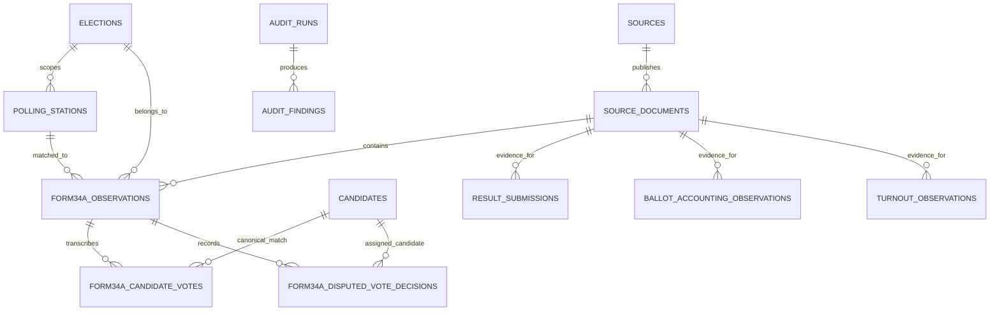

# Form 34A evidence model and reconciliation design

**Status:** implemented local evidence-capture foundation, with automated ingestion still planned. The current schema includes dedicated Form 34A extraction/review tables, and `/form34a` accepts an original PDF/image plus a manual transcription and review attribution. The six-position turnout form is available at `/turnout`. Nationwide retrieval, OCR/automatic extraction, and automatic mapping of Form 34A values into normalized contest tables are not yet implemented.

## 1. Purpose and trust boundary

ETVS — Verified Turnout is an independent, open-source audit of published election information. For Form 34A, its responsibility is to preserve the source document, extract the printed values, validate those values, reconcile them against other published/reference evidence, and expose traceable findings.

ETVS must not:

- update or rewrite an IEBC source document;
- treat an OCR/transcription correction as a change to the original source;
- assume that the newest upload is the correct version when copies disagree;
- treat an arithmetic or source discrepancy alone as proof of fraud; or
- describe the project as an IEBC system or as connected to IEBC production infrastructure.

Every publicly displayed status should be traceable to the original document, the extraction revision, the rule version and the audit run that evaluated it.

## 2. What Form 34A contains

The IEBC-published Form 34A is titled **“Presidential Election Results at the Polling Station”** and is made under regulation 79(2)(a) of the Elections (General) Regulations. The published form contains:

- its serial number and the printed polling-station name/code;
- printed ward, constituency and county names/codes;
- candidate names and the valid votes obtained by each candidate;
- a total valid-votes value in the candidate table;
- a polling-station counts section with registered voters, rejected ballot papers, rejection-objected-to ballot papers, disputed votes and total valid votes;
- a disputed-vote decision table that records ballot-paper serial number(s) and the candidate to whom a vote was assigned, where applicable; and
- declaration/signature/date fields for the presiding officer and deputy presiding officer.

The official form is the field-level reference for the target extraction model. Do not infer that a field exists because it appears on a different electoral form.

**Important limitations of Form 34A:**

1. Form 34A does **not** provide a separate spoilt-ballot count in its polling-station counts block. ETVS must not pretend that this value was read from Form 34A. If spoilt-ballot evidence is needed, link the appropriate separate source.
2. Rejection-objected-to is a separately reported count, but it is not an additional ballot category to add to the rejected total. Under regulation 78(1), it describes a rejection to which a candidate or agent objected; the ballot remains rejected for the polling-station declaration.
3. Under regulation 78(2), a ballot counted but whose validity is disputed is treated as valid for the polling-station declaration. It is therefore not a separate pool of votes to add on top of the candidate totals or total valid votes.
4. The disputed-vote decision rows must be preserved as separate source evidence. Do not infer individual ballot serial numbers from an aggregate disputed-vote count.
5. A blank, unreadable, unreviewed or absent value is not automatically zero.

Review the applicable election's form template and legal amendments before using these rules as a compliance determination. The project should record the exact form/version and legal reference used by its rules.

## 3. Separate the evidence layers

ETVS should distinguish four layers.

### A. Original source

The exact PDF/image bytes and where they came from. Existing tables already provide useful provenance:

- `sources`
- `source_documents`

The document record should retain the source organisation/type, URL or URI, retrieval timestamp and BLAKE3-256 content hash. Preserve the original bytes in controlled storage. A hash lets ETVS compare bytes later; it does not independently prove that the file was genuine when first downloaded.

### B. Extraction observation

A versioned transcription of what the document shows, with its source location and review state. This must not replace or silently update the document itself.

**Implemented extraction tables:**

- `form34a_observations`: one reviewed or reviewable Form 34A instance for one election/station/source-document occurrence.
- `form34a_candidate_votes`: one row per candidate row printed on that Form 34A.
- `form34a_disputed_vote_decisions`: zero or more rows for the disputed-ballot serial/candidate decision entries printed on the form.
- A later `rejection_statement_observations` / `rejection_statement_items` pair, if the separate statutory statement on rejected ballot papers is ingested.

A dedicated form observation should keep both the printed station identity and the matched ETVS station foreign key. A wrong or ambiguous station code is evidence to investigate, not a reason to discard the text printed on the document.

### C. Normalized observations

The current schema has structured data tables for position-specific turnout, registered-voter observations, contest-specific ballot accounting and candidate results:

- `registered_voter_observations`
- `turnout_observations`
- `ballot_accounting_observations`
- `result_submissions`

These tables support the normalized human-entry workflow. The current Form 34A transcription remains in source-specific tables; an automated mapping into normalized contest data is future work and must preserve the source document and extraction revision. A Form 34A count must never silently replace a separate position-turnout observation or a value entered from another evidence source.

The generic `source_submissions` JSONB payload remains useful for generic published-source submissions. The dedicated `form34a_*` tables now provide constrained field-level extraction and disputed-vote decision capture.

### D. Audit findings

Existing `audit_runs` and `audit_findings` separate audit output from source observations. Continue to use this separation. A change in extraction or reference data should produce a new/reproducible audit run, not an in-place edit of old findings.

Existing `published_aggregate_totals` and `source_comparisons` are relevant for comparing source-stated aggregates and cross-document values. Reuse them where their current contracts fit; do not create a duplicate table solely because the source happens to be Form 34A.

## 4. Proposed relationships

The diagram describes the implemented Form 34A relationships; migration 008 creates the observation, candidate-vote and disputed-vote tables, and migration 009 adds review attribution and append-only review events.



### Implemented Form 34A table responsibilities

| Proposed table | One row represents | Key design requirements |
|---|---|---|
| `form34a_observations` | One form occurrence / extraction revision | Election, matched station, source document, printed serial/name/codes, reported aggregate counts, signature-presence observations, extraction method, review state and source page/region |
| `form34a_candidate_votes` | One printed candidate row | Parent observation, row order, printed name, optional canonical candidate match, nullable parsed vote value and field-capture state |
| `form34a_disputed_vote_decisions` | One recorded disputed ballot decision row | Parent observation, printed ballot serial number, printed candidate name, optional canonical candidate match and decision/source position |
| `rejection_statement_observations` (future) | One separate rejection statement tied to an election/contest/station/source | Provenance and review status; never imply it is embedded in Form 34A |
| `rejection_statement_items` (future) | One serial/reason entry in the rejection statement | Preserve the reason as printed; normalize against a controlled reference list only without losing source text |

Use `BIGINT GENERATED ALWAYS AS IDENTITY` for internal observation IDs or follow the repository's established ID convention. Use explicit foreign keys to `elections`, `polling_stations`, `source_documents` and, where matched, `candidates`. Candidate linkage must be election-aware. Keep `row_number` or another stable source ordering key because order and printed names help reviewers trace the source.

## 5. Field-capture and review state

For extracted numeric fields, store the parsed integer separately from its capture state. The recommended field states are:

- `PRESENT`: the value is readable and parsed; zero is a legitimate value.
- `BLANK`: the printed field is blank.
- `ILLEGIBLE`: a value appears to be present but cannot be read confidently.
- `NOT_CAPTURED`: extraction has not yet addressed the field.
- `NOT_APPLICABLE`: the field does not apply to this form instance/version.

A parsed value should be populated only where the status supports a valid value. Preserve the exact printed text where possible and record whether the extraction was manual, OCR-assisted or a reviewed correction. If OCR confidence is stored, define its scale and do not confuse a high OCR confidence score with human verification.

The form-level review state should be independent from the audit result. For example: `UNREVIEWED`, `IN_REVIEW`, `REVIEWED`, `NEEDS_CORRECTION`, `CONFLICTING_COPY`. These are proposed extraction workflow states, not statuses supported by the current `audit_findings.status` check constraint.

Corrections should append a new extraction revision or controlled review event. Do not make an UPDATE overwrite the prior value without a history record. Restrict application-role UPDATE/DELETE rights on finalized source/extraction evidence; reserve schema administration for controlled migration operations.

## 6. Counting semantics and reconciliation identities

ETVS should display reported values, derived values and the formula used for a derivation separately.

### 6.1 Candidate sum and duplicate reported valid totals

Let (V_i) be the valid votes reported for candidate (i).

```text
candidate_vote_sum = SUM(V_i)
```

Compare that sum independently against both places on Form 34A that report total valid votes:

- the total row in the candidate table; and
- item 5 in the polling-station counts block.

These repeated fields should agree with each other and with the sum of the candidate vote rows. If one of the totals is blank or illegible, the comparison is incomplete; do not coerce it to zero.

### 6.2 Derived votes-cast / turnout estimate

For the Form 34A source model, where the reported valid and rejected counts are usable:

```text
form34a_votes_cast_estimate =
    form34a_total_valid_votes + form34a_rejected_ballots
```

```text
form34a_turnout_estimate_percent =
    form34a_votes_cast_estimate
    / form34a_registered_voters * 100
```

This is an **ETVS-derived estimate** calculated from fields on the form, not a separately printed Form 34A turnout field. Keep the denominator and numerator visible in any public display. Avoid division by zero and treat a missing denominator as incomplete.

The rejection-objected-to count is a distinct reported annotation on rejected ballots; do not add it a second time to calculate votes cast. The disputed count is likewise not added to valid votes; the presiding officer's recorded candidate assignment is reflected within candidate/valid totals for the station declaration.

### 6.3 Registered-voter bounds

Where the relevant fields and official register reference are available, test:

```text
form34a_votes_cast_estimate <= form34a_registered_voters
form34a_registered_voters = official_reference_registered_voters
```

The first is an arithmetic/plausibility check using values reported in the form. The second is a comparison between two evidence sources and should be reported separately. A mismatch is a discrepancy for investigation; it is not an automatic fraud conclusion.

### 6.4 Disputed-vote detail

Compare the aggregate disputed-vote count to the number of recorded decision rows when the form copy makes the rows fully readable. Keep the printed ballot serial and assigned candidate as evidence. Any canonical candidate match must preserve the printed name and be reviewable.

Do not assume the form template's visible number of blank rows is a maximum. Store zero-to-many decision rows and preserve the document's page/region references.

### 6.5 Spoilt ballots

Form 34A does not report a separate spoilt-ballot count. Keep any spoilt-ballot evidence obtained through an appropriate separate source in the existing contest accounting model or a properly linked source-specific observation. Never synthesize a spoilt value from a missing Form 34A field or include spoilt ballots in votes cast.

## 7. Reconciliation layers

| Layer | Inputs | What to compare | Typical outcome |
|---|---|---|---|
| Form internal arithmetic | Candidate rows and printed totals from one observation | Candidate sum vs both reported valid totals; reported counts within sensible bounds; objected-to count relative to rejected count | Pass, fail, or review-needed extraction finding |
| Station identity | Printed station/ward/constituency/county identifiers plus election inventory | Printed codes/names against the matched election-specific station and hierarchy | Match, mismatch, ambiguous match |
| Source-copy comparison | Two or more Form 34A copies for the same station | Document hashes, printed values, candidate totals and visible declaration fields | Identical duplicate, consistent copy, conflicting copy |
| Reference-data comparison | Form counts plus official election-specific register/station inventory | Registered-voter count and station existence | Match, missing reference, discrepancy |
| Rejection evidence | Form 34A plus a separately published rejected-ballot statement, if ingested | Aggregate rejected count, listed serials and recorded rejection reasons, within the scope of each source | Reconciled, incomplete, discrepancy |
| Form 34A to Form 34B | Station results and corresponding rows in constituency collation | Candidate totals and the station identity represented in the tallying form | Reconciled or conflict |
| Form 34B to Form 34C | Constituency-level and national published results | Applicable aggregate totals by candidate and contest | Reconciled or conflict |
| Coverage | Expected election-specific station inventory and retrieved forms | Stations with no form, unreadable form, duplicate copies or incomplete processing | Published coverage metric |

The statutory/result-form chain is Form 34A at the polling station, Form 34B for constituency collation of presidential results, and Form 34C for the national presidential declaration. Reconcile only comparable fields at the relevant scope. Different elective positions can have different valid/rejected counts; do not compare every contest as though it were one shared ballot count.

## 8. Audit rules and result statuses

The current engine already uses rule identifiers R001–R021, so **do not assign new meanings to existing R-codes**. Use a separate rule namespace for the Form 34A layer (for example, `F34A-001`, `F34A-002`) until the project's rule catalogue is formally updated.

Suggested Form 34A checks:

| Proposed rule | Check |
|---|---|
| `F34A-001` | Candidate vote sum equals the total valid votes in the candidate table |
| `F34A-002` | Candidate-table valid total equals polling-station-count item 5 |
| `F34A-003` | Rejection-objected-to reported count does not exceed the rejected-ballot count, under the applicable form/legal interpretation |
| `F34A-004` | Derived valid + rejected count does not exceed registered voters |
| `F34A-005` | Form's registered-voter count matches the applicable official station/register reference |
| `F34A-006` | Printed station/administrative identifiers match the matched station and hierarchy |
| `F34A-007` | Disputed-vote aggregate and readable decision rows are reconciled |
| `F34A-008` | Copies for the same station/election have identical or explicitly reconciled content |
| `F34A-009` | Every extracted vote/count and audit result is traceable to its source document and extraction revision |

These are design recommendations, not active rules in `audit_engine.py` today. A rule should record its definition/version, input requirements, actual and comparison values, source evidence, diagnostic message and audit run. If the required source is missing, do not manufacture a PASS result.

The current schema allows `PASSED`, `FAILED` and `WARNING` in `audit_findings.status`. Do not start writing new values such as `INCOMPLETE` or `NEEDS_REVIEW` into that column without a coordinated schema/application migration. Until such a migration exists, represent extraction review states separately and make unevaluated checks visible as unevaluated in reporting.

A failed rule means the rule was violated; it does not by itself establish why the discrepancy occurred or whether it constitutes an electoral offence.

## 9. Source lineage and change handling

For every imported Form 34A, preserve:

- `source_id` and `source_document_id`;
- original `document_uri` or controlled storage URI;
- retrieval timestamp and source URL;
- exact-file `BLAKE3-256` content hash and algorithm;
- election/station match, including the printed station identity;
- page number or source-region reference for extracted values;
- extraction method and revision, capture/review states and reviewer event;
- links from candidate/ballot observations to the source document; and
- audit run/rule version that evaluated the observation.

If the same file is fetched twice, the same cryptographic content hash can identify a byte-identical duplicate. If two copies for the same station have different hashes, do not immediately label this tampering: PDF metadata or scanning can change bytes, and content can also differ. Compare the rendered fields and source context, retain both copies, and open a source-reconciliation case when the results conflict.

The existing project uses BLAKE3-256 fingerprints for supported records and a hash chain for audit findings. Continue to use the project's canonical hash payload contracts; do not invent a second serialization format in the importer without updating the tests and verifier.

## 10. PostgreSQL and GIS reporting

PostgreSQL remains the authoritative relational store. A proposed Form 34A layer should have foreign keys and validation constraints for core identifiers and numeric ranges; provenance and review fields should remain available for all source-derived values. Do not rely on dashboard code alone to enforce essential data integrity.

The current schema does not yet establish a PostGIS location/heat-map contract. GIS is a later extension. When implemented, use a spatially indexed station point or appropriate geometry and maintain the location's provenance/accuracy. Several polling stations can share a physical centre; don't fabricate distinct coordinates for each station.

Recommended dashboard layers:

1. **Evidence coverage:** expected stations, forms retrieved, forms readable, extraction reviewed, and missing/duplicate/conflicting forms.
2. **Audit results:** rule-specific PASS/FAIL/WARNING and unresolved extraction/source issues; allow a user to open the underlying evidence.
3. **Derived turnout:** show the numerator, denominator, formula and source alongside the percentage.
4. **Geographic summary:** aggregate at county/constituency/ward levels, showing the denominator used for coverage and avoiding overinterpretation of raw vote volume.

Use summary views or materialized views for repeated aggregates, but always let a displayed total be traced back to the station-level evidence and the exact audit run.

## 11. Implementation sequence

1. **Baseline and tests:** keep field-level fixtures for PRESENT, BLANK, ILLEGIBLE and zero values.
2. **Evidence model:** implemented in migration 008 and `schema.sql`, with seed/reset and verifier support. Review attribution and events are implemented in migration 009.
3. **Remaining importer:** add optional PDF/OCR extraction with page/region references. OCR output must remain reviewable; uncertain station/candidate matches go to review instead of silent inference.
4. **Mapping and integrity:** map reviewed Form 34A candidate/count data to normalized observations without overwriting manual observations; retain provenance and uniqueness/idempotency.
5. **Audit layer:** `F34A-*` findings are implemented in `audit_engine.py`; preserve existing R001–R021 contracts.
6. **Cross-source reconciliation:** compare duplicate source copies, registered-voter references, rejection statements and Form 34B/34C aggregates.
7. **Public reporting:** expose evidence coverage and rule-level findings first; add PostGIS and heat-map rendering after location provenance and query performance are defined.

The local capture workflow is covered by the PostgreSQL CI smoke test. Do not call automated or nationwide Form 34A ingestion production-ready until source retrieval, extraction, mapping, cross-source reconciliation and access controls are designed and tested.

## 12. Primary source references

- **IEBC, prescribed election forms:** [Form 34A and the other forms in the official IEBC-published PDF](https://www.iebc.or.ke/uploads/resources/579IEcaNwK.pdf). The Form 34A template appears in this PDF and explicitly lists the fields described above.
- **Kenya Law, Elections Act / subsidiary regulations reference:** [Elections Act No. 24 of 2011 (published revised edition)](https://www.kenyalaw.org/kl/fileadmin/pdfdownloads/Acts/ElectionsAct_No24of_2011_New.pdf). The associated Elections (General) Regulations include regulations 77–79 on ballot rejection, rejected-ballot recording and declaration forms. Confirm the applicable amendments and form directions for the election being audited before treating a rule as a legal compliance conclusion.
- **IEBC-published 2022 handling directions:** [Gazette Notice No. 9280](https://www.iebc.or.ke/uploads/resources/ODdCkHH0ht.pdf), useful context for prescribed handling and completion of Form 34A during the 2022 General Election.

These references inform the design, but the project should record the election-specific source version and avoid hard-coding a legal interpretation without review.
